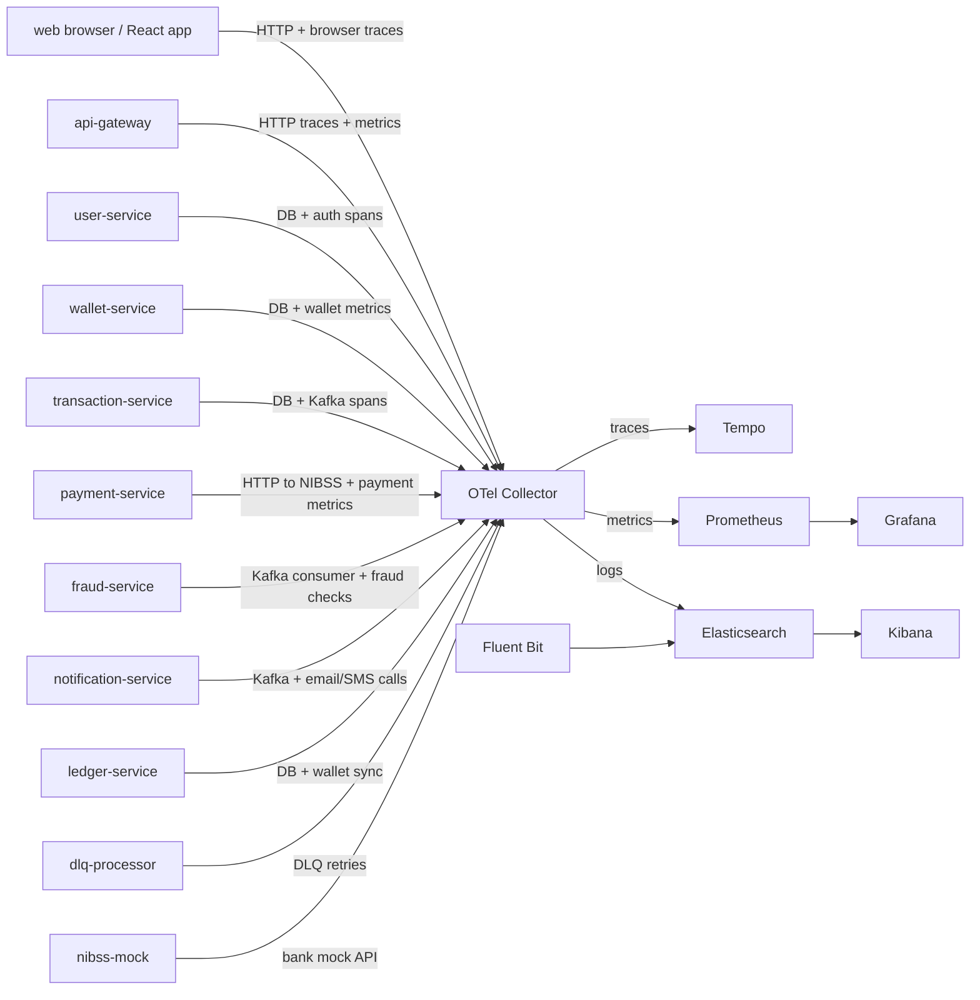
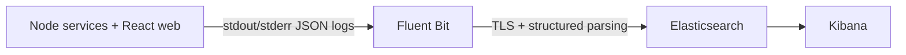

# FinTech Platform

A comprehensive microservices-based fintech platform built with Node.js, React, and PostgreSQL. The platform provides core banking functionality including user management, wallet management, transactions, payments, fraud detection, and notifications.

## Architecture Overview

### Services

1. **API Gateway** (Port 3000)
   - Central entry point for all client requests
   - Authentication and authorization
   - Rate limiting and request validation
   - Routes requests to appropriate microservices

2. **User Service** (Port 3001)
   - User registration and authentication
   - Profile management
   - JWT token generation
   - Redis caching for performance

3. **Wallet Service** (Port 3002)
   - Multi-currency wallet support
   - Account balance management
   - Wallet creation and management
   - Kafka event publishing

4. **Transaction Service** (Port 3003)
   - Transaction processing and ledger
   - Idempotency for safe retries
   - Event-driven transaction updates
   - Integration with ledger service

5. **Payment Service** (Port 3004)
   - External bank transfers
   - NIBSS integration for Nigerian banks
   - Account validation
   - Transfer status tracking

6. **Fraud Service** (Port 3005)
   - Real-time fraud detection
   - Risk scoring
   - Suspicious transaction alerts
   - Configurable fraud rules

7. **Notification Service** (Port 3006)
   - Email notifications via Nodemailer
   - SMS notifications via Twilio
   - Event-driven notifications
   - Transaction confirmations

8. **NIBSS Mock Service** (Port 3007)
   - Mock bank transfer API
   - Account validation simulation
   - Testing and development

9. **Ledger Service** (Port 3008)
   - Posts ledger entries for transactions
   - Coordinates wallet balance updates

10. **DLQ Processor** (Port 3009)
    - Processes messages routed to Kafka dead-letter queues

### Frontend

- **React Web Application** (Port 3010)
  - Modern UI with Tailwind CSS
  - Dashboard with wallet overview
  - Transfer interface
  - Transaction history
  - User profile management
  - Responsive design

## Tech Stack

### Backend
- **Framework**: Express.js
- **Database**: PostgreSQL
- **Cache**: Redis
- **Message Queue**: Kafka
- **Authentication**: JWT
- **Logging**: Winston
- **Validation**: Joi

### Frontend
- **Framework**: React 18
- **Styling**: Tailwind CSS
- **State Management**: Zustand
- **HTTP Client**: Axios
- **Routing**: React Router v6
- **Notifications**: React Hot Toast

### Infrastructure
- **Containerization**: Docker
- **Orchestration**: Docker Compose
- **Workspace**: pnpm and Nx

## Prerequisites

- Docker & Docker Compose
- Node.js 20.19+ or 22.12+ (for local development)
- pnpm 9.8 or later

## Getting Started

### Using Docker Compose (Recommended)

1. **Clone the repository**
   ```bash
   git clone https://github.com/qzee-dev/fintech-platform.git
   cd fintech-platform
   ```

2. **Start all services**
   ```bash
   docker compose up --build
   ```

3. **Wait for services to be ready**
   ```
   Services will be available at:
   - API Gateway: http://localhost:3000
   - Web Frontend: http://localhost:3010
   - User Service: http://localhost:3001
   - Wallet Service: http://localhost:3002
   - Transaction Service: http://localhost:3003
   - Payment Service: http://localhost:3004
   - Fraud Service: http://localhost:3005
   - Notification Service: http://localhost:3006
   - NIBSS Mock: http://localhost:3007
   - Ledger Service: http://localhost:3008
   - DLQ Processor: http://localhost:3009
   - Kafka UI: http://localhost:8080
   ```

### Local Development

1. **Install workspace dependencies**
   ```bash
   pnpm install
   ```

2. **Run an Nx service target** (with its required dependencies configured)
   ```bash
   pnpm nx run user-service:serve
   ```
   The frontend can be run separately with `PORT=3010 REACT_APP_API_URL=http://localhost:3000/api pnpm --dir services/web start`.

## Observability and telemetry standard

This platform follows a single OpenTelemetry contract across all services. The goal is to emit consistent traces, metrics, and JSON logs from every runtime and to route them through the platform telemetry stack.



### Service telemetry contract

Every service is expected to emit the following data types:

- traces: HTTP server/client spans, database spans, Kafka spans, cache spans, and exception events
- metrics: request counters, duration histograms, queue depth, payment attempts, fraud alerts, notification delivery results
- logs: structured JSON with trace_id, span_id, service metadata, and request lifecycle details

### Required resource attributes

Each runtime should define the following attributes:

- service.name
- service.namespace = fintech-platform
- service.version
- deployment.environment.name
- service.instance.id
- host.name

Environment variables used by services:

```env
OTEL_SERVICE_NAME=user-service
OTEL_SERVICE_VERSION=1.0.0
OTEL_SERVICE_INSTANCE_ID=${HOSTNAME}
DEPLOYMENT_ENVIRONMENT=development
OTEL_EXPORTER_OTLP_ENDPOINT=http://otel-collector:4317
PROMETHEUS_METRICS_PORT=9464
```

### Expected scrape data by service

| Service | Required traces | Required metrics | Required logs |
| --- | --- | --- | --- |
| api-gateway | HTTP ingress, upstream HTTP proxy calls, auth validation | request rate, latency, 4xx/5xx, auth failures | access log, proxy failures |
| user-service | login/register/profile DB and auth flows | login attempts, auth failures, profile operations | auth and profile actions |
| wallet-service | wallet lookup/update DB spans | wallet balance reads, wallet creation, balance errors | wallet operations |
| transaction-service | transaction DB spans and Kafka produce events | transaction attempts, success/failure, latency | transaction lifecycle logs |
| payment-service | payment DB spans and outbound NIBSS HTTP | payment attempts, payout success/failure | transfer and validation failures |
| fraud-service | Kafka consumer spans and fraud rule evaluations | fraud checks, high-risk alerts, blocked events | fraud decisions and alerts |
| notification-service | Kafka consumer spans and email/SMS outgoing calls | message processed, delivery failure counts | notification dispatch and errors |
| ledger-service | ledger DB writes and wallet update calls | ledger postings, balance sync failures | ledger posting log events |
| dlq-processor | Kafka consumption and retry span flow | dead-letter reprocessing counts | retry and dead-letter errors |
| nibss-mock | mock bank HTTP endpoints and validation requests | validation attempts, response latency | mock bank interactions |
| web | browser page loads, fetch calls, user actions | frontend request latency, page load timing | browser errors and API failures |

### Metrics conventions

Services should emit:

- counters for cumulative total events
- histograms for durations and latency distributions
- gauges for current resource levels
- up-down counters for queues or concurrency-sensitive values

Avoid high-cardinality labels such as user IDs, emails, request IDs, full URLs, raw tokens, or account numbers.

### EFK stack

The log pipeline is intentionally single-path and avoids duplicate ingestion:



- services write structured JSON logs to stdout/stderr
- Fluent Bit tails container logs and enriches them with pod metadata
- Elasticsearch stores logs with retention and index lifecycle settings
- Kibana provides searchable trace correlation and operational dashboards

Important: do not forward the same application logs directly through both Fluent Bit and OTLP unless deduplication is explicitly configured.

### Trace to log and log to trace correlation

Every structured log should contain:

- timestamp
- level
- message
- service.name
- service.version
- deployment.environment.name
- service.instance.id
- trace_id
- span_id
- request_id
- http.request.method
- http.response.status_code
- error.type
- error.message

This allows engineers to jump from a trace in Tempo to the matching logs in Kibana and back again.

## API Endpoints

### Authentication
- `POST /api/auth/login` - User login
- `POST /api/auth/register` - User registration
- `POST /api/auth/verify-token` - Verify a token
- `GET /api/profile/...` - User profile routes

### Wallet Management
- `GET /api/wallet/user/:userId` - Get user wallets
- `POST /api/wallet/create` - Create new wallet
- `GET /api/wallet/:walletId` - Get wallet details

### Transactions
- `POST /api/transaction/create` - Create transaction
- `GET /api/transaction/:transactionId` - Get transaction details
- `GET /api/transaction/wallet/:walletId` - Get wallet transactions

### Payments
- `POST /api/payment/bank-transfer` - Initiate bank transfer
- `GET /api/payment/status/:reference` - Check transfer status
- `POST /api/payment/validate-account` - Validate account number

### Fraud Detection
- `POST /api/fraud/check` - Check transaction for fraud
- `GET /api/fraud/alerts/:userId` - Get fraud alerts for user

### Notifications
- `POST /api/notification/email` - Send email
- `POST /api/notification/sms` - Send SMS

The API Gateway health endpoint is `GET /health`. The project does not currently
serve Swagger UI at `/api-docs`; the endpoint reference is in [docs/API.md](docs/API.md).

## Environment Variables

Compose reads the following optional values from a root `.env` file:
```env
JWT_SECRET=replace-this-development-secret
EMAIL_USER=your-email@example.com
EMAIL_PASSWORD=your-email-app-password
TWILIO_ACCOUNT_SID=your-twilio-sid
TWILIO_AUTH_TOKEN=your-twilio-token
TWILIO_PHONE=your-twilio-phone-number
```

Compose configures service-to-service URLs and Kafka internally. PostgreSQL uses
`fintech_user` / `fintech_secure_password` and database `fintech_db` as defined
in `docker-compose.yaml`; `FRAUD_THRESHOLD` is currently set there to `500000`.

## Testing

Run the service tests with Nx, for example `pnpm nx run user-service:test`.

## Project Structure

```
fintech-platform/
├── services/
│   ├── api-gateway/
│   ├── dlq-processor/
│   ├── fraud-service/
│   ├── ledger-service/
│   ├── mock-services/nibss-mock/
│   ├── notification-service/
│   ├── payment-service/
│   ├── transaction-service/
│   ├── user-service/
│   ├── wallet-service/
│   ├── web/
│   └── web-e2e/
├── libs/shared-libs/
├── docs/
├── docker-compose.yaml
├── package.json
└── pnpm-workspace.yaml
```

## Key Features

✅ **User Management**
- Secure authentication with JWT
- Password hashing with bcrypt
- Redis session caching

✅ **Wallet Management**
- Multiple wallets per user
- Real-time balance updates
- Account freeze functionality

✅ **Transaction Processing**
- Idempotent transaction creation
- Event-driven processing
- Ledger integration
- Transaction status tracking

✅ **Payment Processing**
- Bank transfer support
- NIBSS integration
- Account validation
- Payment status monitoring

✅ **Fraud Detection**
- Real-time fraud scoring
- Configurable detection rules
- Alert system
- Suspicious transaction logging

✅ **Notifications**
- Email notifications
- SMS alerts via Twilio
- Event-driven delivery
- Transaction confirmations

✅ **Modern Frontend**
- Responsive design
- Real-time dashboard
- Secure token management
- Intuitive user interface

## Performance Considerations

- **Caching**: Redis for session and user data caching
- **Async Processing**: Kafka for asynchronous event handling
- **Database Optimization**: Indexed queries and proper schema design
- **Rate Limiting**: API gateway rate limiting
- **Idempotency**: Safe retry mechanisms for transactions

## Security Features

- JWT-based authentication
- Password hashing with bcrypt
- CORS protection
- Input validation with Joi
- Rate limiting
- Transaction idempotency for replay attack prevention
- Fraud detection

## Monitoring & Logging

- Winston logging across all services
- Structured logging with timestamps
- Error tracking and reporting
- Service health checks

## Future Enhancements

- [ ] Two-factor authentication (2FA)
- [ ] Mobile app (React Native)
- [ ] Advanced analytics dashboard
- [ ] Machine learning fraud detection
- [ ] Cryptocurrency integration
- [ ] API rate limiting per user
- [ ] Transaction scheduling
- [ ] Multi-signature authorization
- [ ] Compliance reporting
- [ ] Audit logging

## Contributing

1. Fork the repository
2. Create a feature branch
3. Commit your changes
4. Push to the branch
5. Create a Pull Request

## License

MIT License - see LICENSE file for details

## Support

For support, email support@fintech.com or open an issue on GitHub.

## Authors

- **Qoseem Oluwaphemy** - Initial development

## Acknowledgments

- Express.js community
- React community
- PostgreSQL documentation
- Kafka documentation
