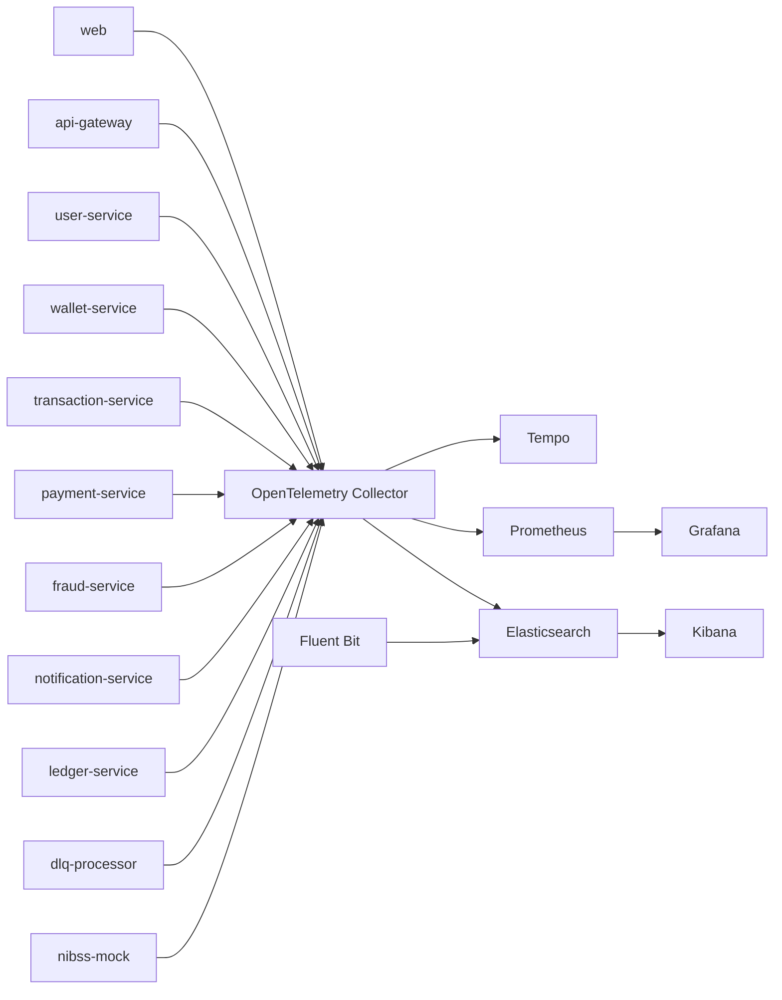

# OpenTelemetry and EFK observability contract

This document defines the single telemetry contract for the fintech platform application services and the platform-side log pipeline.

## Architecture



## Service contract

Each service must expose:

- OpenTelemetry traces on OTLP
- Prometheus metrics on port 9464
- structured JSON logs on stdout/stderr
- trace_id and span_id in logs when a span is active

## Required environment variables

```env
OTEL_SERVICE_NAME=user-service
OTEL_SERVICE_VERSION=1.0.0
OTEL_SERVICE_INSTANCE_ID=${HOSTNAME}
DEPLOYMENT_ENVIRONMENT=development
OTEL_EXPORTER_OTLP_ENDPOINT=http://otel-collector:4317
PROMETHEUS_METRICS_PORT=9464
```

## Data types by service

| Service | Traces | Metrics | Logs |
| --- | --- | --- | --- |
| api-gateway | inbound HTTP, upstream proxy calls, auth validation | request rate, latency, 4xx/5xx, auth failures | gateway access and proxy errors |
| user-service | login/register/profile DB spans, auth flows | login attempts, auth failures, profile operations | auth and profile events |
| wallet-service | wallet CRUD DB spans | wallet creation, balance checks, updates | wallet lifecycle events |
| transaction-service | DB and Kafka spans | attempts, successes, failures, retries | transaction lifecycle |
| payment-service | external bank HTTP spans, DB writes | payment attempts, validations, failures | transfer and validation events |
| fraud-service | Kafka consume spans, risk evaluation | fraud checks, alerts, blocked events | fraud decisions |
| notification-service | Kafka and provider outbound calls | notifications sent, failed deliveries | notification event logs |
| ledger-service | ledger DB writes and wallet sync calls | ledger postings, reconciliation failures | posting and sync events |
| dlq-processor | Kafka retry spans | retry rates, DLQ processing counts | DLQ backlog recovery |
| nibss-mock | mock bank request spans | validation requests, latency | mock provider calls |
| web | browser traces, fetch spans | page load timing, API latency | browser errors and API failures |

## Log schema

Structured logs should follow this pattern:

```json
{
  "timestamp": "2026-11-11T12:00:00.000Z",
  "level": "info",
  "message": "Payment submitted",
  "service": {
    "name": "payment-service",
    "namespace": "fintech-platform",
    "version": "1.0.0",
    "instanceId": "payment-service-abc123"
  },
  "deployment": {
    "environment": "development"
  },
  "trace_id": "...",
  "span_id": "...",
  "request_id": "...",
  "http": {
    "method": "POST",
    "status_code": 200
  },
  "error": {
    "type": "",
    "message": ""
  }
}
```

## EFK pipeline

- services write JSON logs to stdout/stderr
- Fluent Bit tails container logs and enriches fields
- Elasticsearch indexes logs using a standard lifecycle policy
- Kibana provides search and dashboards
- the pipeline intentionally does one log path only to avoid duplicates

## Security and data hygiene

Do not log:

- passwords or tokens
- raw authorization headers
- full PAN data
- raw external API secrets
- personal data beyond operational identifiers

## Collector contract

The OTel Collector should receive OTLP on:

- gRPC: 4317
- HTTP: 4318

It should export:

- traces to Tempo
- metrics to Prometheus
- logs to the logging path that is configured for the environment

## Platform ownership

- application repo owns service instrumentation
- GitOps repo owns infrastructure-level telemetry deployment and dashboards
- both must share the same naming, resource, and log metadata contract
