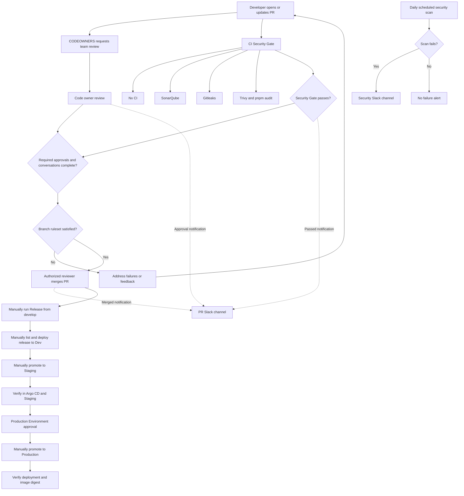

# Pull Request and Release Runbook

This runbook describes the checked-in GitHub Actions and CODEOWNERS setup, the
repository configuration needed to enforce it, and the operator steps from a
pull request through deployment. A workflow being present in Git does not mean
that its secrets, external services, or environments are configured.

## 1. Workflow at a glance

```text
Developer opens or updates PR to develop or main
  -> CODEOWNERS requests the appropriate team(s)
  -> CI Security Gate runs Nx CI, SonarQube, Gitleaks, and dependency scans
  -> Required "Security Gate" check must pass before merge
  -> PR Lifecycle Notifications posts a Slack message when the current PR head
     passes, when any approval is recorded, and when the PR is merged
  -> Authorized reviewer merges the PR
  -> Release and environment deployment workflows are run manually
```

The notifications are informational. Slack messages and CODEOWNERS alone do
not enforce merge requirements; branch rulesets do.

## Lifecycle diagram



The solid arrows show required workflow/review progression; dashed arrows are
notifications only. The scheduled scan is independent of the PR path. Dev,
staging, and production deployment steps are manual, and the deployment
placeholders listed below must be configured before using them.

## 2. Team ownership

The repository's [CODEOWNERS](../.github/CODEOWNERS) file routes review requests:

| Area | Requested owner(s) |
| --- | --- |
| Files without a more specific rule | `@Coreinfra-Labs/platform` |
| Backend services | `@Coreinfra-Labs/backend` |
| Web application and E2E tests | `@Coreinfra-Labs/frontend` |
| Shared libraries | `@Coreinfra-Labs/backend`, `@Coreinfra-Labs/maintainers` |
| General workflows | `@Coreinfra-Labs/platform` |
| Release, deployment, and PR notification workflows | `@Coreinfra-Labs/platform`, `@Coreinfra-Labs/maintainers` |
| Security automation and Dependabot | `@Coreinfra-Labs/devsecops`, `@Coreinfra-Labs/security` |
| CODEOWNERS governance | `@Coreinfra-Labs/security`, `@Coreinfra-Labs/maintainers` |

Before relying on routing:

1. Add the listed teams to the repository with appropriate access (normally
   write access for reviewers).
2. Ensure each team has active members who can receive and act on review
   requests.
3. Keep the team slug and path rules in CODEOWNERS synchronized when teams or
   ownership change.

When multiple teams are listed for a path, GitHub requests those owners; this
does not create a "one approval from every team" policy. A CODEOWNER approval
requirement means an eligible code owner must approve the changed owned files.
The current notification workflow reports any submitted approval; it does not
verify that the approver belongs to `maintainers`, `platform`, or another
particular team.

## 3. Configure the branch ruleset

Configure this in the repository (not in a workflow file):

1. Open **Settings > Rules > Rulesets > New branch ruleset**.
2. Name it, for example, **Protected integration branches**.
3. Set **Enforcement status** to **Active**.
4. Target both `main` and `develop` with exact branch-name include patterns.
5. Do not add bypass actors for normal development. If an emergency bypass is
   retained, limit it to named administrators and document its use.
6. Enable the following rules:

   **Require a pull request before merging**
   - Require **1 approving review** as the baseline.
   - Enable **Require review from Code Owners**.
   - Enable **Dismiss stale pull request approvals when new commits are pushed**.
   - Enable **Require approval of the most recent reviewable push**.
   - Enable **Require conversation resolution before merging**.

   **Require status checks to pass**
   - Create a pull request to each target branch and let the workflow run at
     least once if GitHub has not yet populated its check list.
   - Select the `Security Gate` job check produced by the **CI Security Gate**
     workflow. Verify the selected check is from **GitHub Actions**. The
     workflow name is `CI Security Gate`; the aggregate job/check name is
     `Security Gate`.
   - For the strongest freshness policy, enable **Require branches to be up to
     date before merging**. This may require developers to update their PR
     branches more often.

   **Protect the branch**
   - Enable **Restrict deletions** and **Block force pushes**.
   - Keep bypass permissions empty or tightly controlled.

7. Save the ruleset and verify its status is **Active** and its target patterns
   match both branches.

Do not select a similarly named standalone check as a substitute for
`Security Gate`: the aggregate job is designed to fail if Nx CI, SonarQube,
Gitleaks, or the dependency scan does not succeed. Review the required-check
list again if that job is renamed.

### Approval policy limitation

The baseline above requires at least one approval and a code-owner approval for
owned files; the same review can satisfy both requirements. GitHub does not use
the Slack approval notification to require a specific role. The current
CODEOWNERS entries that list both platform and maintainers allow a code owner
from that matching owner list to satisfy the code-owner requirement.

If policy requires a **maintainer specifically** for release/deployment changes,
make `@Coreinfra-Labs/maintainers` the sole code owner for those sensitive
paths, then keep **Require review from Code Owners** enabled. A larger general
approval count by itself does not guarantee that a named team supplied one of
the approvals.

## 4. Configure integrations and secrets

Add credentials under **Settings > Secrets and variables > Actions**. Use
environment-scoped secrets for deployment credentials where appropriate; do
not paste webhook URLs or private keys into workflow files.

| Secret / configuration | Used for | Notes |
| --- | --- | --- |
| `PR_NOTIFICATION_WEBHOOK_URL` | PR checks-passed, approval, and merge Slack messages | Use a Slack incoming webhook for the intended review channel. |
| `SECURITY_SLACK_WEBHOOK_URL` | Scheduled security and other security/release notifications | Keep the security channel and access separate from general PR notifications if desired. |
| SonarQube AWS access | SonarQube credentials | `sonarqube.yaml` currently hard-codes AWS account `517714604478` and role `GitHubAction-AssumeRoleWithAction`, then reads `sonar/sonarqube/token` and `sonar/sonarqube/url` from AWS Secrets Manager. Confirm the account/role are intended, the role trust policy allows this repository/workflow, and the secret JSON keys match. |
| `AWS_ROLE_ARN`, `AWS_ACCOUNT_ID` | Release and deployment workflows | Configure AWS OIDC trust and least-privilege permissions for the repository and environment. |
| `EKS_CLUSTER_NAME` | Dev EKS deployment | Add as a variable (not a secret) to the GitHub `dev` Environment. The Dev workflow stops with a clear error if it is missing, then checks that the cluster is `ACTIVE`. |
| `RELEASE_APP_ID`, `RELEASE_APP_PRIVATE_KEY` | Staging GitHub App access | App must have only the required repository permissions and access to source/GitOps repositories. |
| `GH_APP_ID`, `GH_APP_PRIVATE_KEY` | Production GitHub App access | Configure the app with least privilege and access only to the required source/GitOps repositories. |
| `ARGOCD_AUTH_TOKEN` | Staging/production Argo CD operations | Prefer an environment-scoped token with least privilege. |
| `GITLEAKS_LICENSE` | Gitleaks scan, if the configured scan requires it | Add the license secret if applicable to the repository's Gitleaks plan. |

Configure GitHub Actions to be enabled for the repository and allow the actions
used by these workflows. Keep `GITHUB_TOKEN` permissions restricted; the
PR notification workflow's checks-passed job specifically needs `issues: write`
to add its per-commit duplicate-suppression marker.

## 5. Pull request operating procedure

### Developer

1. Create a feature branch and open a PR targeting `develop` for normal
   integration work. Target `main` only for an explicitly intended
   main-bound change or promotion.
2. Describe the change, testing performed, risk, and any migration or rollout
   impact. For a security finding, include the affected component, severity,
   impact, remediation, and a tracking link where available.
3. Wait for requested CODEOWNER reviews and the required checks. Push fixes to
   the same PR; stale approvals may be dismissed by the ruleset.
4. Resolve review conversations and wait for `Security Gate` to pass again on
   the latest head commit.

### Reviewers and maintainers

1. Review the diff and relevant test/security results. Ensure the required
   code-owner approval is present for owned files.
2. An approval Slack message means an approval was submitted; it is not proof
   that all review requirements or checks are complete.
3. Merge only when the ruleset reports all requirements satisfied. Use the
   repository's chosen merge method consistently.

### What notifications do

- **Checks passed:** sent only after a successful `CI Security Gate` run when
  the associated PR is still open, non-draft, targets `main` or `develop`, and
  still has the same head commit. A marker comment prevents duplicate
  checks-passed messages for that commit.
- **Approval:** sent for any submitted approval on a PR targeting `main` or
  `develop`; it does not identify a special approval tier.
- **Merge:** sent when one of those PRs is merged.
- **Failures:** the PR lifecycle notifier intentionally does not send a Slack
  message for every failed PR check. Use the GitHub check/run details to debug.
- **Scheduled security failure:** `Security - Scheduled` runs daily at
  02:00 UTC and manually. `Security - Notification` posts to the security Slack
  webhook when that scheduled workflow fails. The same SCA reusable workflow
  also runs inside the PR gate.

## 6. Dependency and security follow-up

- Dependabot is configured in [dependabot.yml](../.github/dependabot.yml) for
  weekly npm and GitHub Actions updates. It requests the security or devsecops
  team according to ecosystem. Major version updates are currently ignored.
- Review Dependabot PRs like other PRs; do not merge an update solely because
  the bot opened it. Run the required checks and assess breaking changes.
- Investigate Trivy/pnpm findings using the workflow run and its uploaded
  reports. The Slack security summary provides status, high/critical counts,
  and up to five findings; it is a summary, not the complete report.
- The scheduled Slack alert is triggered by a failed scheduled workflow. For
  PR-time failures, use the GitHub `Security Gate` check and its job artifacts.

## 7. Release and deployment procedure

The release and cloud deployment workflows are manually operated and currently
contain unresolved environment placeholders. Do not use them for a real
deployment until the blockers below are resolved and a safe end-to-end test has
passed.

1. Confirm the intended commit is merged to `develop` and has passing checks.
2. Run **Release** manually from `develop`, selecting a supported service and
   an unused version in `vMAJOR.MINOR.PATCH` form. The workflow publishes an
   image and release metadata to ECR.
3. Run **Deploy Selected Releases To Dev** manually. First choose `list` to
   inspect successful Release runs, then choose `deploy` with the selected
   release run ID(s). This workflow is not automatically started by the Release
   workflow.
4. Run **Deploy Staging** manually with the successful `release_run_id` from
   `develop`. It validates the run and its release artifact before updating
   staging GitOps and waiting for Argo CD.
5. Promote to production only after the release has completed the required
   staging verification and the authorized release approver has approved the
   change. Run **Deploy Production** manually with the release run ID, release
   ID, service, and version.
6. Verify workflow completion, deployment health, and the deployed image
   digest in the target environment. Deployment completion messages to Slack
   are not currently implemented by the checked-in deployment workflows;
   verify GitHub Actions and Argo CD directly.

### Deployment blockers to clear first

- Configure the Dev GitHub Environment with variable `EKS_CLUSTER_NAME` and
  secrets `AWS_ROLE_ARN` and `AWS_ACCOUNT_ID`. The workflow validates that the
  cluster name and account ID are configured and that AWS reports the EKS
  cluster as `ACTIVE`.
- Configure the AWS IAM role's GitHub OIDC trust for this repository and the
  `dev` environment. Give it only the ECR read permissions and
  `eks:DescribeCluster` needed by the workflow.
- Grant the assumed IAM role EKS cluster access and Kubernetes RBAC limited to
  the `dev` namespace. The workflow needs to inspect and update the selected
  service Deployment and verify its rollout; it should not need cluster-admin.
- Ensure the EKS worker nodes/pods can pull the published ECR image. This is
  separate from the GitHub Actions runner's ECR read access.
- Staging and production contain `YOUR_ORG`, source/GitOps repository, and
  `YOUR_ARGOCD_SERVER` placeholders. Staging also has a `YOUR-GITOPS-REPO`
  placeholder in its GitHub App configuration.
- Configure the `dev`, `staging`, and `production` GitHub Environments as
  appropriate. For production, add required reviewers and prevent self-review
  where supported. Confirm the staging/production workflows use the intended
  environment-scoped credentials.
- Configure the AWS OIDC trust policies, ECR repositories, GitHub App access,
  Argo CD endpoints/tokens, and GitOps repository structure expected by the
  workflows.
- The runbook's manual workflow steps are not themselves a deployment
  authorization boundary. Protect the GitHub Environments and restrict who can
  dispatch deployment workflows.

## 8. Verification checklist

Before announcing this process as operational, confirm all of the following:

- [ ] Team slugs in CODEOWNERS exist, have repository access, and have active
      reviewers.
- [ ] Both `main` and `develop` are targeted by an active ruleset.
- [ ] A test PR demonstrates CODEOWNER requests and a required `Security Gate`
      check.
- [ ] The ruleset blocks merge when the gate fails, review is missing, or a
      conversation is unresolved.
- [ ] PR notification webhook sends checks-passed, approval, and merge
      messages to the intended channel.
- [ ] Security webhook receives a scheduled-scan failure alert; do not create a
      production vulnerability solely to test it.
- [ ] Dependabot opens PRs with the expected reviewers and labels.
- [ ] The `dev` GitHub Environment has `EKS_CLUSTER_NAME`, `AWS_ROLE_ARN`, and
      `AWS_ACCOUNT_ID` configured, and the workflow can access the intended EKS
      cluster and only the required `dev` namespace resources.
- [ ] Dev, staging, and production placeholders and credentials are replaced
      and validated in a non-production-safe test.
- [ ] Authorized deployment reviewers can approve the protected environment;
      unauthorized users cannot deploy.
- [ ] Operators know to use GitHub Actions and Argo CD for deployment status
      until deployment Slack notifications are implemented.

## 9. Troubleshooting

| Symptom | Check |
| --- | --- |
| No CODEOWNER request | Confirm the changed file matches a CODEOWNERS pattern, the team slug is correct, and the team has repository access. |
| `Security Gate` is absent from ruleset check selection | Run a PR against the target branch and wait for the workflow to finish; then select the aggregate `Security Gate` job check. |
| Required check stays pending | Confirm the workflow ran for the PR's current head and the required-check context is the `Security Gate` job from GitHub Actions. |
| Checks-passed Slack message is missing | Confirm the gate succeeded for the current PR head, the PR is open/non-draft and targets `main` or `develop`, and `PR_NOTIFICATION_WEBHOOK_URL` is configured. |
| Approval/merge Slack message is missing | Confirm the PR base is `main` or `develop` and the webhook is valid. These notifications are triggered by review submission and merge events. |
| Security Slack message is missing | Confirm the scheduled workflow failed, the notification workflow ran, and `SECURITY_SLACK_WEBHOOK_URL` is configured. |
| Deployment fails before doing work | Check the placeholders, GitHub Environment approvals/secrets, AWS OIDC trust, app repository access, artifact/run ID, and Argo CD settings. |
